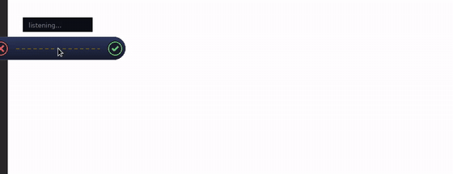
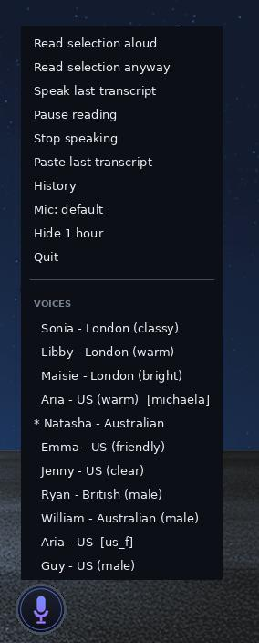

# HarfDown2List

Floating-bubble voice dictation for Linux/X11: press the pill to talk, press
again to stop — clean text is pasted straight into whatever text box you had
selected. Speech in, text out, 100% local by default.

<p align="center">
  
</p>

<p align="center">
  <sub>The idle pill &nbsp;·&nbsp; the right-click menu</sub><br>
  
  &nbsp;&nbsp;&nbsp;
  
</p>

> **📖 Updated 18 Nov 2026** — this README is current with `main` as it
> stands. The voice read-back was retuned: three cinematic personas —
> `aria_cinema` (slow, low, narrator-style), `ava_rich` (Ava
> multilingual) and `lisboa` (Raquel, native Portugal accent, so
> European Portuguese never drifts to Brazil) — and the speech software
> is identical to the agent's MCP `speak` tool: edge-tts 7.x synthesis
> through `ffplay`, with **no fallback engines** — if the cloud is down,
> the read-back stays silent and logs why. It never falls back to a
> robotic voice. The tuning workflow is documented in
> [Voice read-back](#voice-read-back-what-actually-happened-and-how-to-tune-it).

## Quick start

```bash
sudo apt install python3 python3-venv python3-pip xdotool xclip \
                 libportaudio2 fonts-dejavu-core ffmpeg \
                 libnotify-bin
git clone https://github.com/muntzy8u/HarfDown2List.git
cd HarfDown2List
python3 -m venv venv
./venv/bin/pip install -r requirements.txt
./venv/bin/python main.py
```

First run downloads the Whisper models (~500 MB) and warms them (~15 s)
before the pill appears.

## How to use it

A small pill floats at the bottom-center of your screen. It never steals
keyboard focus, so text lands wherever you last clicked — any app, any
monitor, any workspace.

    click the pill   ->  flow bar: [X] [waveform] [tick]
    tick             ->  transcribe -> paste at your cursor
    cross (X)        ->  cancel, discard audio
    click waveform   ->  pause / resume mid-dictation
    hold the pill    ->  push-to-talk (release to transcribe + paste)
    Esc (anywhere)   ->  cancel the open session
    drag             ->  reposition; release near a screen edge to snap
    right-click      ->  menu (paste last, history, mic, voice, hide, quit)

A one-line live transcript floats above the bar while you speak. If no
window is focused when you finish, the paste keystroke is skipped and your
text is left safely on the clipboard.

## Requirements

- **Linux + X11.** No Wayland support — the overlay needs X SHAPE.
- A working microphone (any PulseAudio/PipeWire source; pick via
  `pactl set-default-source` or `MIC_SOURCE` in `config.py`).
- The `apt` packages above (`xdotool` and `xclip` are the paste path).
- Python ≥ 3.13 recommended (developed on 3.13.5).
- Optional: [Ollama](https://ollama.com) (or any server speaking its
  `/api/chat`) for the LLM polish pass.
- Piper TTS was removed entirely in this update.

## Config highlights

Everything tunable lives in `config.py` — edit, then restart the app:

- `PARTIAL_MODEL` / `FINAL_MODEL` — Whisper models (defaults: `tiny.en`
  live preview + `small` final pass, CPU int8).
- `LLM_POLISH` / `LLM_POLISH_MODEL` — optional cleanup pass that removes
  fillers and resolves self-corrections. If the endpoint is down or slow,
  the raw transcript ships immediately; dictation never blocks on it.
- `MIC_SOURCE`, `TTS_ENABLED`, `TTS_PERSONA`, bar sizes, session caps,
  paste method — all documented inline in `config.py`.

## Known limitations

- **X11 only** — no Wayland, and not useful headless: this is a desktop
  overlay, not a CLI service.
- First run downloads Whisper models (and optionally a TTS voice); that
  can take a while.
- The dictation path is single-language by default (English models);
  swap `PARTIAL_MODEL`/`FINAL_MODEL` for multilingual variants.
- Sessions cap at 10 minutes so a forgotten recording can't run forever.
- A self-correction spoken in a *new* session can't retro-edit the
  previous transcript — use "paste last" from the right-click menu.

## Voice read-back: what actually happened, and how to tune it

The read-back engine is `edge-tts` (Microsoft cloud neural voices) —
the same software the agent-facing MCP `speak` tool runs, played through
`ffplay`. There are **no fallback engines and no robotic last resort**:
if the cloud is unreachable, nothing is spoken and the reason lands in
the log. Every utterance is supervised (watchdog, temp-file cleanup, one
voice at a time). Two things worth knowing:

- **espeak-ng and piper were removed entirely** in this update —
  espeak-ng was the robotic last resort. The one realistic failure mode
  left is Microsoft answering 403 while rotating its handshake token
  (the `Sec-MS-GEC` logic that `edge-tts` 7.x keeps updated) — and that
  now ends in a logged error and silence.
- **New personas**: `aria_cinema` (US Aria, slower and lower —
  narrator-style), `ava_rich` (Ava multilingual, the richest US female
  rendering edge-tts serves) and `lisboa` (Raquel, native European
  Portuguese — reads Portuguese from Portugal, not Brazil). Same engine,
  new delivery dials.
- **Live translation is Raquel's job**: select the `lisboa` persona and
  Raquel translates English on the fly with the local ollama LLM and
  speaks the translation natively in European Portuguese. The right-click
  toggle (**“Raquel: translate to Português”** / **“Raquel: read as
  written”**) flips her behaviour, persisted in `translate.json`. Every
  other persona reads the text exactly as written — the voice you select
  always wins. If the LLM is unreachable, Raquel reads the original text
  and the reason is logged. Dictation (STT) remains English-only — swap
  `PARTIAL_MODEL`/`FINAL_MODEL` for multilingual Whisper models if you
  ever want that too.

### Using Raquel day to day

1. **Pick her voice** — restart the app, right-click the pill and, in the
   `VOICES` list, choose **Raquel - Lisboa (pt-PT, cinematic)** (the star
   marks the current voice; the choice is remembered in `voice.json`).
   Her translate switch sits right under her row.
2. **Set the mode** — click **Raquel: translate to Português** to have her
   translate, or **Raquel: read as written** to hear the original text in
   her voice. A notification confirms each flip; the choice is
   remembered in `translate.json`.
3. **Read something** — highlight English text anywhere and choose
   **Read selection aloud** (or **Read selection anyway** for an older
   highlight). Raquel translates on the fly and speaks the Portuguese.

What the terminal running `main.py` shows when she speaks a translation:

    ── Raquel - Lisboa (pt-PT, cinematic) (o que ela vai dizer) ──
    <the exact European Portuguese text she is reading>

That block is printed flush with the audio, so you can read the
Portuguese sentence **while she says it** — the block is the study text,
her voice is the pronunciation. The usual log lines keep flowing around
it (`speaking with edge (...)`, watchdog notes, and, if the LLM is
unreachable, `translation to ... failed` after which she reads the
original English instead).

**Study-loop tip**: highlight a sentence, read it, follow the terminal
block, then read the same selection again — same translation, same
block, so you can listen and read along as many times as you like.
Stop Speaking works mid-sentence for every voice, Raquel included.

Tuning is audition-first — nothing is written until you keep it:

    venv/bin/python voice_preview.py --list
    venv/bin/python voice_preview.py --persona michaela --rate -8% --pitch -2Hz
    venv/bin/python voice_preview.py --persona aria_cinema
    venv/bin/python voice_preview.py --persona ava_rich

`--save` writes the tweaked rate/pitch/volume back into `voice_out.py`
(a `.bak` copy is made first) and takes effect on the next app start.

Note for agent sessions that use the MCP `speak` tool: that server
resolves the same `edge-tts` binary family (7.x, same cloud voices) and
never falls back to a robotic voice — it reports an error instead. It shares
nothing local with this app, and running both at once can put two
voices on the speakers.

## Documentation

- [docs/ARCHITECTURE.md](docs/ARCHITECTURE.md) — how it works, what runs
  where, the file map
- [docs/CONFIGURATION.md](docs/CONFIGURATION.md) — every knob: models,
  polish endpoint, voices, selection read-back, vocabulary, logs
- [docs/STATUS.md](docs/STATUS.md) — verified-behaviour checklist and
  design notes

## License

MIT — see [LICENSE](LICENSE).