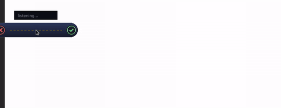
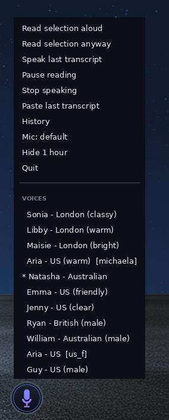

# HarfDown2List

Floating-bubble voice dictation for Linux/X11: press the pill to talk, press
again to stop — clean text is pasted straight into whatever text box you had
selected. Speech in, text out, 100% local by default.

<p align="center">
  
</p>

| Idle pill | Right-click menu |
| --- | --- |
|  |  |

## Quick start

```bash
sudo apt install python3 python3-venv python3-pip xdotool xclip \
                 libportaudio2 fonts-dejavu-core pulseaudio-utils \
                 espeak-ng libnotify-bin
git clone https://github.com/muntzy8u/HarfDown2List.git
cd HarfDown2List
python3 -m venv venv
./venv/bin/pip install -r requirements.txt
./venv/bin/python main.py
```

First run downloads the Whisper models (~500 MB) and warms them (~15 s)
before the pill appears.

## How to use it

A small pill floats at the bottom-center of your screen. It never steals
keyboard focus, so text lands wherever you last clicked — any app, any
monitor, any workspace.

    click the pill   ->  flow bar: [X] [waveform] [tick]
    tick             ->  transcribe -> paste at your cursor
    cross (X)        ->  cancel, discard audio
    click waveform   ->  pause / resume mid-dictation
    hold the pill    ->  push-to-talk (release to transcribe + paste)
    Esc (anywhere)   ->  cancel the open session
    drag             ->  reposition; release near a screen edge to snap
    right-click      ->  menu (paste last, history, mic, voice, hide, quit)

A one-line live transcript floats above the bar while you speak. If no
window is focused when you finish, the paste keystroke is skipped and your
text is left safely on the clipboard.

## Requirements

- **Linux + X11.** No Wayland support — the overlay needs X SHAPE.
- A working microphone (any PulseAudio/PipeWire source; pick via
  `pactl set-default-source` or `MIC_SOURCE` in `config.py`).
- The `apt` packages above (`xdotool` and `xclip` are the paste path).
- Python ≥ 3.13 recommended (developed on 3.13.5).
- Optional: [Ollama](https://ollama.com) (or any server speaking its
  `/api/chat`) for the LLM polish pass.
- Optional: piper TTS voice (~63 MB, downloaded on first speech, offline
  afterwards).

## Config highlights

Everything tunable lives in `config.py` — edit, then restart the app:

- `PARTIAL_MODEL` / `FINAL_MODEL` — Whisper models (defaults: `tiny.en`
  live preview + `small` final pass, CPU int8).
- `LLM_POLISH` / `LLM_POLISH_MODEL` — optional cleanup pass that removes
  fillers and resolves self-corrections. If the endpoint is down or slow,
  the raw transcript ships immediately; dictation never blocks on it.
- `MIC_SOURCE`, `TTS_ENABLED`, `TTS_PERSONA`, bar sizes, session caps,
  paste method — all documented inline in `config.py`.

## Known limitations

- **X11 only** — no Wayland, and not useful headless: this is a desktop
  overlay, not a CLI service.
- First run downloads Whisper models (and optionally a TTS voice); that
  can take a while.
- The dictation path is single-language by default (English models);
  swap `PARTIAL_MODEL`/`FINAL_MODEL` for multilingual variants.
- Sessions cap at 10 minutes so a forgotten recording can't run forever.
- A self-correction spoken in a *new* session can't retro-edit the
  previous transcript — use "paste last" from the right-click menu.

## Documentation

- [docs/ARCHITECTURE.md](docs/ARCHITECTURE.md) — how it works, what runs
  where, the file map
- [docs/CONFIGURATION.md](docs/CONFIGURATION.md) — every knob: models,
  polish endpoint, voices, selection read-back, vocabulary, logs
- [docs/STATUS.md](docs/STATUS.md) — verified-behaviour checklist and
  design notes

## License

MIT — see [LICENSE](LICENSE).